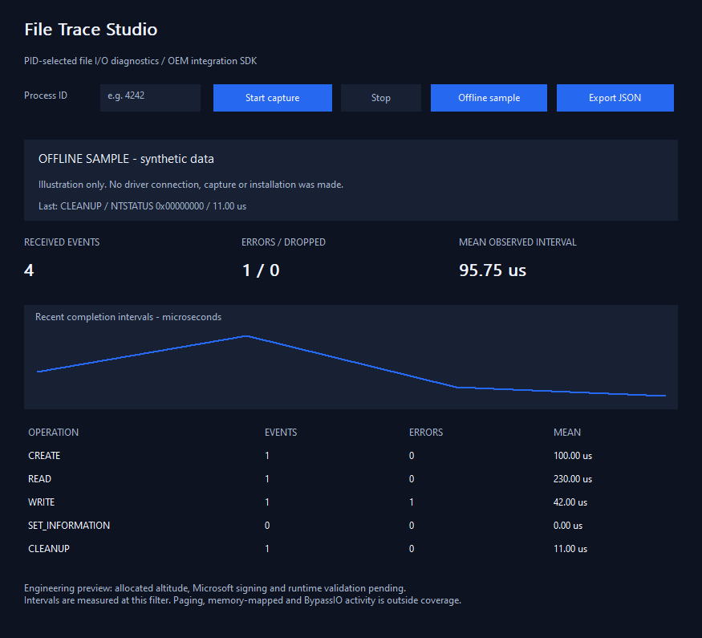

# File Trace Studio

**Windows file I/O completion diagnostics with a native C++ application and a small OEM SDK.** Select one process and inspect operation counts, non-success statuses, successful transfer sizes and the interval between our minifilter's pre/post callbacks.

<!-- full-version-contact:start -->
> [!IMPORTANT]
> **Full version and commercial licensing**
>
> **Discord username: `titancsa`**
>
> Open Discord, choose **Friends > Add Friend**, enter **`titancsa`**, then send a direct message. Mention **File Trace Studio** and ask about the **full / production version, commercial use or OEM redistribution**.
>
> Include your intended use and deployment size to discuss pricing, availability and the appropriate licensing / access instructions.
<!-- full-version-contact:end -->



**Engineering preview:** the application and SDK compile and pass offline tests. The evaluation minifilter compiles with static analysis, but its Microsoft altitude allocation, signing, installation and runtime validation are pending. This release does not include an installable driver and cannot perform live capture by itself. No sample or fabricated altitude is used.

## Try the application

Download the portable application from [Releases](https://github.com/titanfyre/File-Trace-Studio/releases). Extract the entire ZIP and open `FileTraceStudio.exe`. Choose **Offline sample** to inspect the interface without a driver, elevation, installation or capture. Sample data is visibly labelled synthetic.

The live workflow, after a properly allocated, signed and validated package is available, is:

1. Install that driver package; no unsigned package is supplied in this preview.
2. Run the application as administrator.
3. Find the target process ID in Task Manager > Details, enter its PID and choose **Start capture**.
4. Reproduce the problem, choose **Stop**, then **Export JSON**. Existing report files are preserved.

Only one administrator capture client can connect at a time. Closing the application stops its capture. Process identity is retained internally, so reuse of a PID does not select an unrelated new process.

The CLI provides `FileTraceCLI.exe --sample` for offline illustration and `FileTraceCLI.exe <PID> [seconds]` for a future live session of 1 to 3600 seconds. It reports explicit connection/compatibility errors rather than silently falling back to simulated data.

## What is measured

| Field | Meaning |
| --- | --- |
| CREATE, READ, WRITE, SET_INFORMATION, CLEANUP | Completion of the registered operation observed at this filter |
| PID | The explicitly selected requesting process |
| NTSTATUS | The operation's completion result; the error count includes warning/error results for which `NT_SUCCESS` is false |
| Requested / successful bytes | Read/write request size and successful completion size; metadata operations use zero |
| Completion interval | QPC ticks between our pre/post callbacks, converted to microseconds |
| Dropped | Observations lost when the bounded ring/context pool is full, or a batch cannot be copied to the client |

Intervals include work and waiting below the filter and scheduling effects. They are **not** disk hardware latency, time attributable to an individual third-party driver, end-user application latency or proof of the cause of a slowdown. Async operations may complete out of issue order; records are ordered by completion sequence, not their start time.

Coverage is deliberately limited to the selected process on local NTFS/ReFS volumes. Paging I/O is excluded; memory-mapped operations, offloaded transfers, BypassIO reads, other volumes and requestor attribution outside the selected process can be absent. The filter allows BypassIO instead of disabling DirectStorage to increase apparent trace coverage. A loss count of zero does not establish completeness.

The driver never records file contents, names, command lines or kernel pointers. It never changes or blocks the underlying I/O, calls a network service, scans for malware, or waits for a user-mode decision. The application exports local summaries only. Monitoring has overhead; no zero-overhead or production compatibility guarantee is claimed.

## Use the C++ SDK

Add `SDK/FileTrace.cpp` and `SDK/FileTrace.h` to a Windows C++17 x64 project and link `FltLib.lib`. Demo/evaluation driver source is documented in [driver/README.md](driver/README.md) and is not required to compile the application.

```cpp
#include "FileTrace.h"
#include <iostream>

int main() {
    FileTrace::Client trace;
    FileTrace::Batch batch;
    DWORD error = trace.Connect();
    if (!error) error = trace.Start(GetCurrentProcessId(), batch);
    if (error) { std::cerr << FileTrace::Error(error); return 1; }

    // Perform a known file operation in this process, then read its observations.
    error = trace.Read(batch);
    if (!error)
        for (const auto& event : batch.events)
            std::cout << FileTrace::Operation(event.Operation) << ": "
                      << FileTrace::Microseconds(event, batch.status.Frequency)
                      << " us\n";
    trace.Stop(batch); // Destructor also closes the owning connection.
    return error ? 1 : 0;
}
```

`Connect`, `Start(pid, batch)`, `Read(batch)`, `Status(batch)` and `Stop(batch)` return a Windows error code; `0` means success. `Error(code)` produces an English explanation. Reads remove up to 64 completion records from a 1024-record ring. The SDK validates the version, sizes, counts and record fields. A client instance is intended for one controlling thread; externally serialize access if needed. See [the wire contract](docs/PROTOCOL.md).

## Build and validation

Demo/evaluation driver source is available; see [driver/README.md](driver/README.md) for
build instructions and separate evaluation-source terms. Those terms apply to
Titan-authored driver code. Third-party source licenses and existing application/SDK
licenses remain applicable. Full/commercial implementation and private signing or
activation material are excluded.

Install Visual Studio 2022 C++ desktop tools, CMake and a Windows SDK, then run:

```powershell
./Build.ps1
./Build.ps1 -AddressSanitizer
```

Executables are in `obj/Build/bin/Release`. The public app/SDK are MIT licensed; the prebuilt driver has separate evaluation/commercial terms. There is no enforced timed trial or online activation in this preview. [Validation details](docs/VALIDATION.md) distinguish offline tests from still-pending driver tests.

## OEM integration

This project is aimed at embedding bounded diagnostics in a support tool, application regression lab or managed endpoint workflow. [Process Monitor](https://learn.microsoft.com/en-us/sysinternals/downloads/procmon) and Windows ETW already provide mature tracing; this is a focused SDK preview, not a claim to replace them.

For integration, redistribution terms and support, contact **`titancsa` on Discord**. Microsoft signing is a prerequisite for applicable Windows loading policies, not a reliability guarantee, Windows certification or a grant to run arbitrary kernel code. Desktop Windows 10 2004+ and Windows 11 x64 are the intended validation targets; Windows Server and WHCP/HLK certification are not claimed.

Use this software only on systems you own or are authorized to diagnose and respect applicable privacy and software policies. It was created for legitimate engineering and support. The author does not authorize unlawful use and provides the software without warranty to the extent permitted by law; see [LICENSE](LICENSE).

<!-- central-sdk-packages:start -->
## SDK : langages et installation

Les sources, licences, guides API et exemples sont regroupes dans [le depot SDK dedie](https://github.com/TitanCSA/sdk-packages/tree/main/projects/File-Trace-Studio). Choisis le langage de ton application puis execute sa commande dans son dossier.

| Langage / registre | Disponibilite | Installation / utilisation |
| --- | --- | --- |
| C++ / vcpkg | Registre TitanCSA disponible (configuration ci-dessous) | `vcpkg install file-trace-studio:x64-windows` |
| C++ / Conan | Registre TitanCSA disponible (configuration ci-dessous) | `conan install --requires=file-trace-studio/0.1.0 -r titancsa --build=missing -s compiler.cppstd=17` |
| C++ / NuGet natif | Publie et verifie | `Install-Package File-Trace-Studio.Native -Version 0.1.0` |
| C# / .NET | Publie et verifie | `dotnet add package FileTraceStudio.SDK --version 1.0.0` |
| Python / pip | Pas encore disponible / validation en cours | Commande prevue apres publication : `python -m pip install file-trace-studio==1.0.0` |
| Python / Conda | Canal TitanCSA disponible ; acceptation conda-forge encore en attente | `conda install --override-channels -c https://raw.githubusercontent.com/TitanCSA/sdk-packages/089bc73095aa8eda89bacbe10d0b9e58394b0207/conda-channel -c conda-forge file-trace-studio` |
| Rust / Cargo | Publie et verifie | `cargo add file-trace-studio@1.0.0` |
| JavaScript et TypeScript / npm | Pas encore disponible / validation en cours | Commande prevue apres publication : `npm install file-trace-studio@1.0.0` |
| Java et Kotlin / Maven Central | Publie et verifie | `io.github.titancsa:file-trace-studio:1.0.0 (pom.xml / Gradle)` |
| Java et Kotlin / JitPack | Publie et verifie | `com.github.titanfyre:File-Trace-Studio:java-sdk-v1.0.0 (avec le depot JitPack)` |
| Go / Go Modules | Publie et verifie | `go get github.com/titanfyre/File-Trace-Studio/File-Trace-Studio-Go-modules@v1.0.0` |
| Go / pkg.go.dev | Publie et verifie | `Documentation : https://pkg.go.dev/github.com/titanfyre/File-Trace-Studio/File-Trace-Studio-Go-modules@v1.0.0` |
| PowerShell / Gallery | Publie et verifie | `Install-Module FileTraceStudio -RequiredVersion 1.0.0 -Scope CurrentUser` |
| Dart et Flutter / pub.dev | Pas encore disponible / validation en cours | Commande prevue apres publication : `dart pub add file_trace_studio:1.0.0` |
| Ruby / RubyGems | Publie et verifie | `gem install file-trace-studio -v 1.0.0` |
| PHP / Composer | Pas encore disponible / validation en cours | Commande prevue apres publication : `composer require titancsa/file-trace-studio:1.0.0` |

Pour vcpkg et Conan, configure d abord le registre TitanCSA avec [le guide complet](https://github.com/TitanCSA/sdk-packages/tree/main/projects/File-Trace-Studio/README.md). Le guide explique aussi Maven/Gradle, les prerequis et le chargement des DLL. Les pilotes/applications du produit sont installes separement. Les commandes marquees prevues ne sont pas encore disponibles.

Les anciens imports Go et versions JitPack gardent leurs tags. Pour les anciennes archives SDK, utilise [les liens de remplacement](https://github.com/TitanCSA/sdk-packages/blob/main/release-assets/URL-MIGRATION.json).
<!-- central-sdk-packages:end -->
